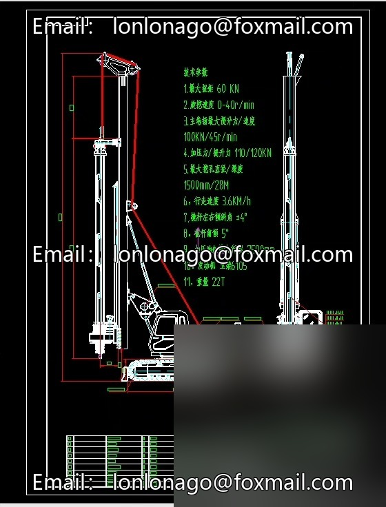
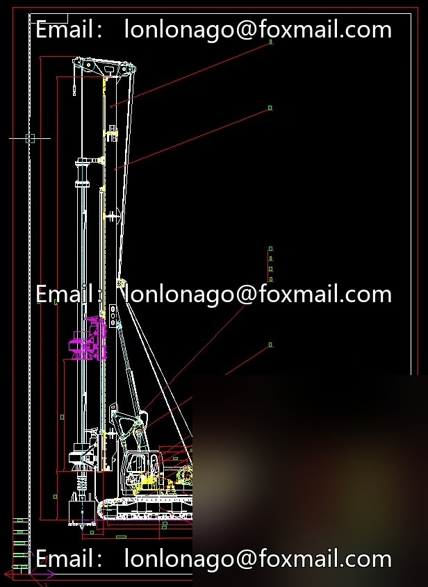
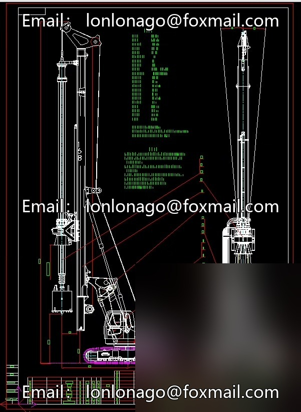

# A032 rotating drilling machine design drawing; rotating drilling machine two-dimensional design drawing; rotating drilling machine design CA

## Body

A032 rotary drilling machine design drawings; two-dimensional design drawings of rotary drilling machine; design CAD drawings of rotary drilling machine

The design includes two-dimensional drawings, design CAD and technical parameters; the images show technical parameters and numeric values.

<!-- AI_ENRICHED -->

## Images

## Payment

Here is a pay link on Stripe ( https://buy.stripe.com/3cs8yP7sY87d0vu9AB ). Please contact me lonlonago@foxmail.com after funding $89, and I will send you a complete data files , thank you!

